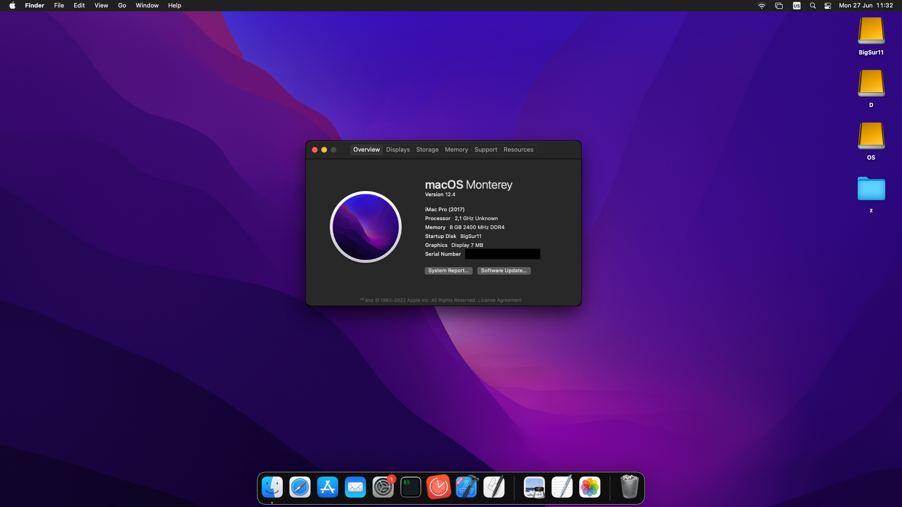
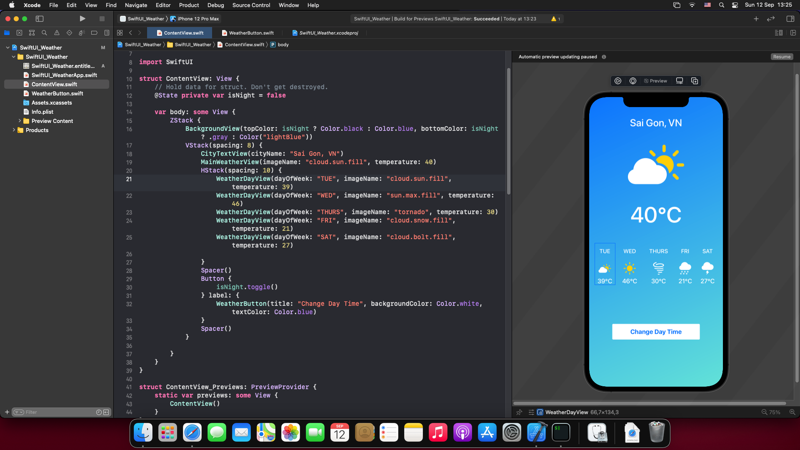

# 💻 Hackintosh on AMD Laptop (OpenCore)

[](https://www.apple.com/macos/monterey/)
[](https://github.com/acidanthera/OpenCorePkg)

An OpenCore EFI configuration tuned for AMD Ryzen laptops running **macOS Monterey 12.4**. Tested and optimized on the **ASUS Vivobook A412D**.



> ⚠️ **Important Notice**: This EFI is provided as a baseline reference. Because ACPI tables vary between laptop models and motherboard firmware, dumping your own SSDTs using **SSDTTime** is strongly recommended to prevent Kernel Panics.

---

## 📋 Table of Contents
  - [💻 Hardware Specifications](#-hardware-specifications)
  - [⚡ Status \& Compatibility](#-status--compatibility)
  - [🧩 Key Features \& Drivers](#-key-features--drivers)
  - [🛠️ Installation Guide](#️-installation-guide)
    - [1. Generating System-Specific SSDTs](#1-generating-system-specific-ssdts)
    - [2. Config.plist \& SMBIOS Setup](#2-configplist--smbios-setup)
    - [3. Recommended Boot Arguments](#3-recommended-boot-arguments)
  - [🔧 Post-Installation](#-post-installation)
  - [📁 Repository Structure](#-repository-structure)
  - [🙌 Credits](#-credits)

---

## 💻 Hardware Specifications

| Component | Details |
| :--- | :--- |
| **Model** | ASUS Vivobook A412D |
| **CPU** | AMD Ryzen™ 5 3500U (4 Cores / 8 Threads) |
| **iGPU** | AMD Radeon™ Vega 8 Graphics |
| **Wireless / BT** | Intel® Dual Band Wireless-AC 8265 |
| **Audio** | AMD K17.1 Audio / Realtek High Definition Audio |
| **Input** | PS/2 Keyboard & Precision Touchpad |
| **Storage** | NVMe SSD |
| **Target OS** | macOS Monterey 12.4 |
| **Bootloader** | OpenCore `v0.9.3` |

---

## ⚡ Status & Compatibility

| Feature | Status | Notes |
| :--- | :---: | :--- |
| **CPU Power Management** | ✅ Working | Handled by `SMCAMDProcessor` & `AMDRyzenCPUPowerManagement` |
| **iGPU Graphics Acceleration** | ✅ Working | Driven by `NootedRed.kext` |
| **Wi-Fi** | ✅ Working | Handled by `itlwm.kext` + `HeliPort.app` |
| **NVMe Drive** | ✅ Working | Power management enabled via `NVMeFix` |
| **Keyboard & Touchpad** | ✅ Working | Handled via `VoodooPS2Controller` & `ECEnabler` |
| **Battery Indicator** | ✅ Working | Managed via `SMCBatteryManager` |
| **Audio / Microphone** | ⚠️ Partial / WIP | Requires setting your specific `alcid` layout |
| **Bluetooth / DRM** | ⚠️ Varies | Configuration dependant |

---

## 🧩 Key Features & Drivers

| Kext / Driver | Description |
| --- | --- |
| **`NootedRed.kext`** | Provides Lilu-based graphics acceleration for AMD Vega iGPUs (*replaces WhateverGreen*). |
| **`SMCAMDProcessor.kext`** | AMD CPU temperature monitoring & power metrics integration with VirtualSMC. |
| **`itlwm.kext` + `HeliPort**`** | Intel Wi-Fi driver support pairing with the HeliPort tray menu bar utility. |
| **`ECEnabler.kext`** | Fixes Embedded Controller issues across various laptop models. |
| **`USBToolBox.kext`** | Port mapping driver paired with `UTBMap.kext` / `UTBDefault.kext`. |

---

## 🛠️ Installation Guide

### 1. Generating System-Specific SSDTs

To avoid Kernel Panics caused by ACPI mismatches on your specific laptop:

1. Download and run [SSDTTime](https://github.com/corpnewt/SSDTTime) on your target hardware (Windows or Linux).
2. Select option **`P`** to dump your current system's DSDT.
3. Generate the required table patches:
- **FixHPET**: Option `C` (Patches conflicting IRQs from legacy devices).
- **USBX**: Option `B` (Default key).
- **RTCAWAC**, **PluginType**, **FakeEC**, **PNLF**, and **XOSI** (Option `A`).


4. Copy all generated `.aml` files to `EFI/OC/ACPI/`.
5. Merge the output `patches_OC.plist` into your `config.plist` using SSDTTime's patch merge tool or manual editing.

---

### 2. Config.plist & SMBIOS Setup

> ⚠️ **Do not use the repository SMBIOS details directly!** Generate your own unique credentials.

Use [GenSMBIOS](https://github.com/corpnewt/GenSMBIOS) to generate new serial numbers and hardware identity keys for `PlatformInfo -> Generic`:

- **SystemProductName**: Recommended target SMBIOS (e.g., `MacBookPro16,3` or `MacBookPro15,4` based on your specs).
- Populate the following fields in `config.plist`:
- `MLB`
- `SystemSerialNumber`
- `SystemUUID`
- `ROM`


---

### 3. Recommended Boot Arguments

Navigate to `NVRAM -> Add -> 7C436110-AB2A-4BBB-A880-FE41995C9F82 -> boot-args`:

```sh
-v keepsyms=1 debug=0x100 npci=0x2000 vsmcgen=1 alcid=<your-layout-id> agdpmod=pikera

```

- `-v`: Verbose boot mode for debugging.
- `npci=0x2000`: Required for AMD boot compatibility.
- `vsmcgen=1`: Essential flag for VirtualSMC on AMD.
- `alcid=XX`: Replace `XX` with your specific Realtek / AMD layout ID for audio.
- `agdpmod=pikera`: Resolves black screen issues post-boot.

---

## 🔧 Post-Installation

1. **Wi-Fi Connection**: Install the included **HeliPort** app (found in the repository or download latest release) to control Wi-Fi networks managed by `itlwm.kext`.
2. **USB Port Mapping**: Customize your USB mapping with [USBToolBox](https://github.com/USBToolBox/tool) and replace `UTBDefault.kext` with your generated `UTBMap.kext`.
3. **iGPU Acceleration**: Ensure `NootedRed.kext` is loaded correctly in `config.plist` kernel order and `WhateverGreen.kext` is disabled/removed.

---


## 📁 Repository Structure

```text
EFI/
├── BOOT/
│   └── BOOTx64.efi
└── OC/
    ├── ACPI/
    │   ├── SSDT-EC.aml
    │   ├── SSDT-HPET.aml
    │   ├── SSDT-PLUG-ALT.aml
    │   ├── SSDT-PNLF.aml
    │   ├── SSDT-USBX.aml
    │   └── SSDT-XOSI.aml
    ├── Drivers/
    │   ├── HfsPlus.efi
    │   ├── OpenCanopy.efi
    │   └── OpenRuntime.efi
    ├── Kexts/
    │   ├── AMDRyzenCPUPowerManagement.kext
    │   ├── AmdTscSync.kext
    │   ├── AppleALC.kext
    │   ├── AppleMCEReporterDisabler.kext
    │   ├── ECEnabler.kext
    │   ├── itlwm.kext
    │   ├── Lilu.kext
    │   ├── NootedRed.kext
    │   ├── NVMeFix.kext
    │   ├── RadeonSensor.kext
    │   ├── SMCAMDProcessor.kext
    │   ├── SMCBatteryManager.kext
    │   ├── SMCRadeonGPU.kext
    │   ├── USBToolBox.kext
    │   ├── UTBDefault.kext
    │   ├── VirtualSMC.kext
    │   └── VoodooPS2Controller.kext
    ├── Resources/
    └── config.plist

```

---



*Running a SwiftUI App in Xcode 🥳*

---

## 🙌 Credits

- [Acidanthera](https://github.com/acidanthera) for OpenCore Bootloader and core kexts (`Lilu`, `VirtualSMC`, `AppleALC`, etc.).
- [ChefKissInc / NootedRed](https://github.com/ChefKissInc/NootedRed) for AMD iGPU graphics acceleration.
- [CorpNewt](https://github.com/corpnewt) for `SSDTTime` and `GenSMBIOS`.
- [OpenIntelWireless](https://github.com/OpenIntelWireless) for `itlwm` and `HeliPort`.
- [TrungNhai](https://www.google.com/search?q=https://github.com/trungnhai) & the Hackintosh community for AMD laptop support tools.
